<p align="center"></p>

# Finpal

An investing buddy inside your wallet. **Pal** turns idle savings into a first, well-understood investment, funded with **PayPal**.

**Built for the PayPal AI Hackathon 2026**


Finpal is a web app that you can use in two views:

- **Desktop**: the full app in the browser, with a sidebar and wide tables.
- **Mobile**: the same app inside a phone frame, with bottom tabs and bottom sheets, so you can try the mobile experience from a laptop.

Payments run for real against the **PayPal Sandbox**, with test accounts and test money. Asset prices are illustrative.

> Finpal is an independent hackathon concept. It is not affiliated with or endorsed by PayPal. Payments run on the PayPal Sandbox. Pal provides education, not financial advice.

## Screenshots

| Home | Pal | Starter portfolio | You're invested |
|---|---|---|---|
| 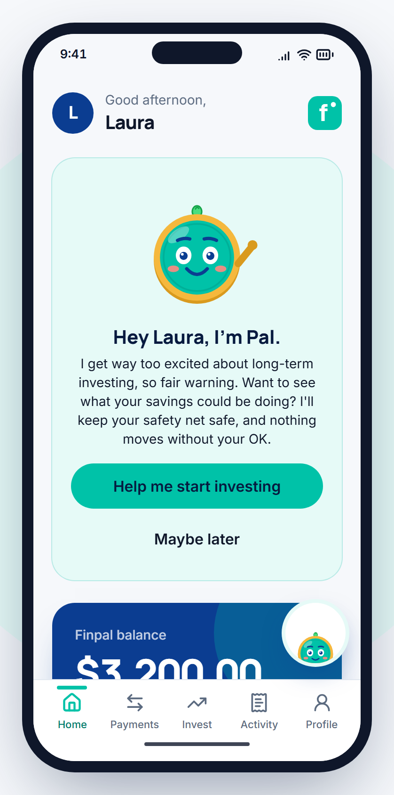 | 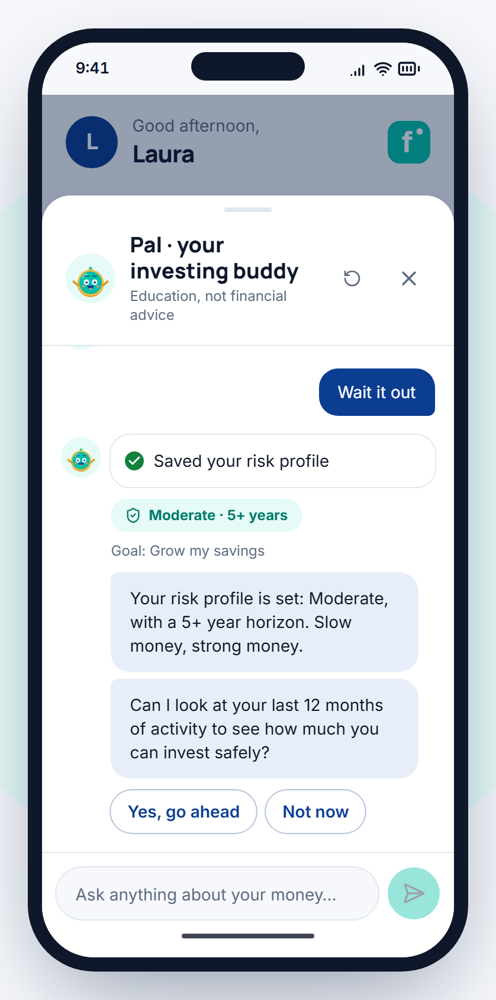 | 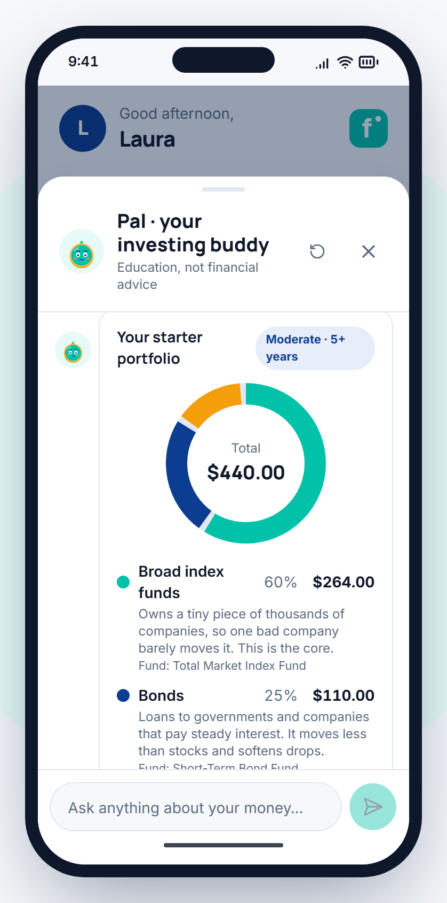 | 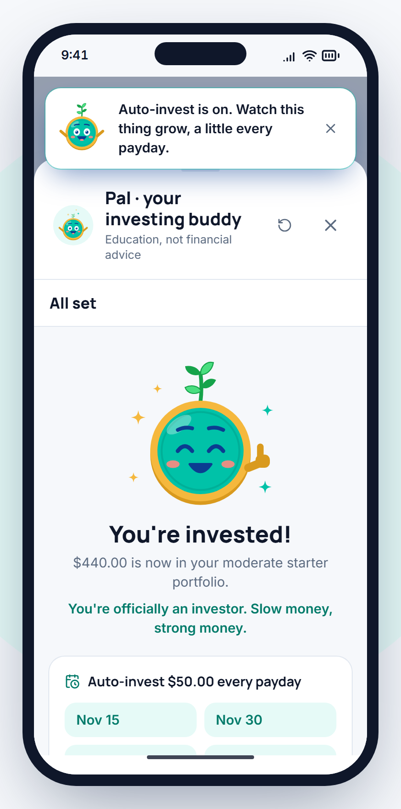 |

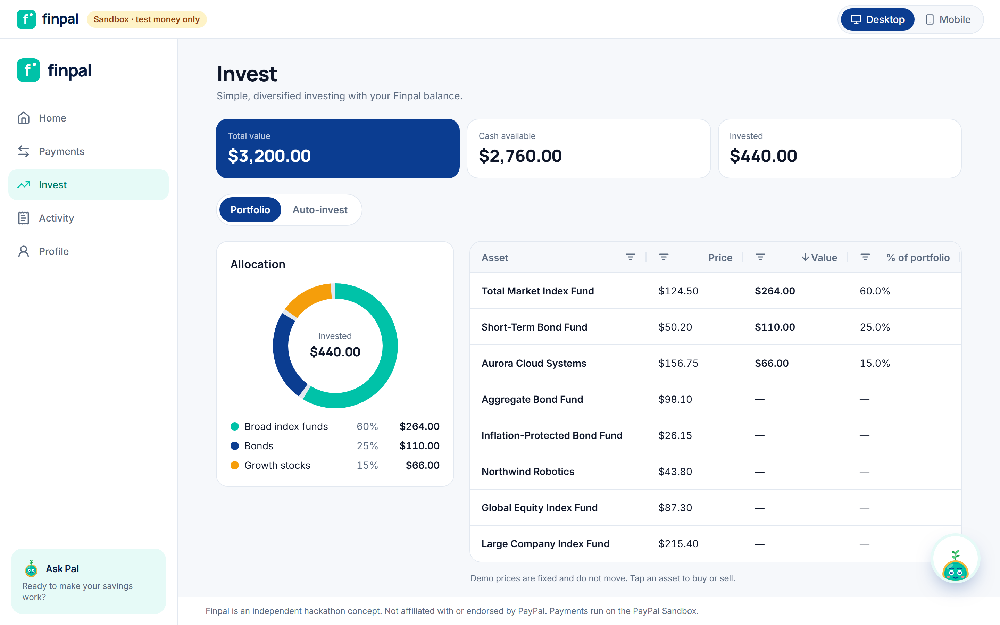

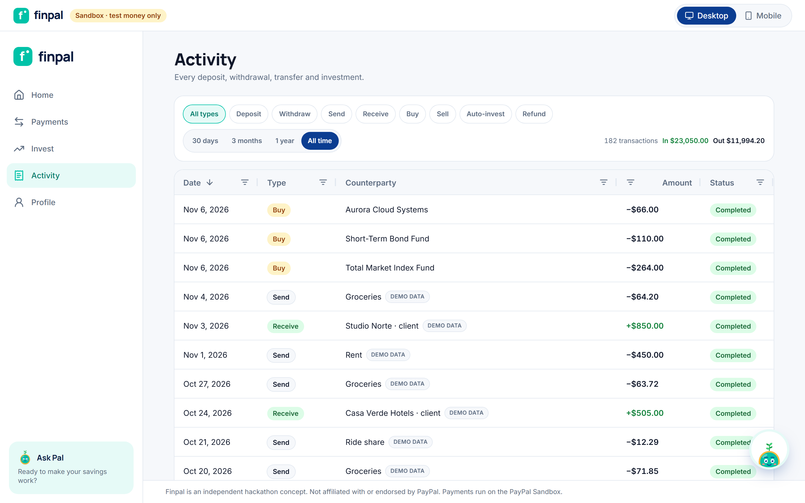

## The problem

Many people keep their savings in a digital wallet balance. Freelancers who get paid in dollars are a big part of that group. The money is safe, but it does not grow, and inflation slowly reduces what it can buy.

Most of them would like to invest, but they never start. Brokers feel intimidating, they don't know how much they can safely invest, and nobody explains the risks in plain language before they put money in.

## Meet Pal

Pal is Finpal's investing buddy: a small coin with a face and a sprout on top. He's a passionate long-term investor who loves compound growth, diversification and patience, and he coaches you like a friend on your first run.

| Seed | Sprout | Plant | Tree |
|---|---|---|---|
| 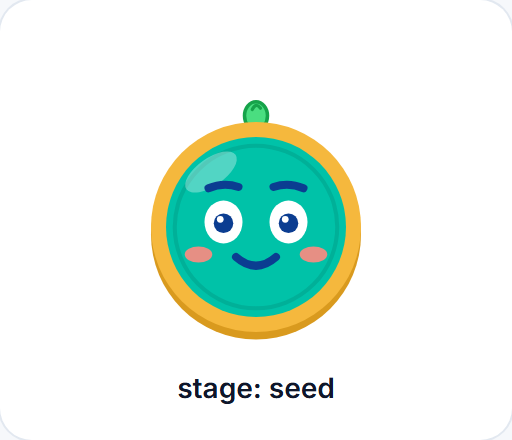 | 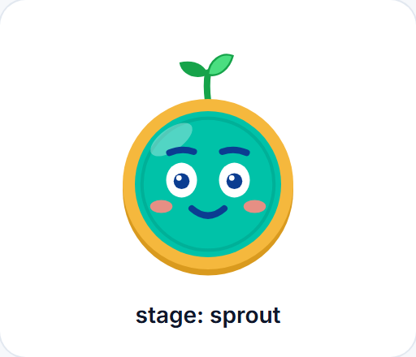 | 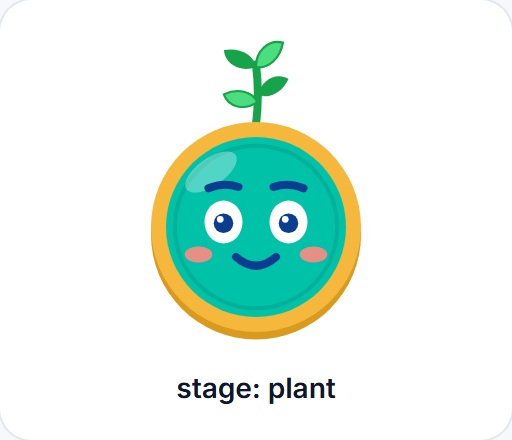 | 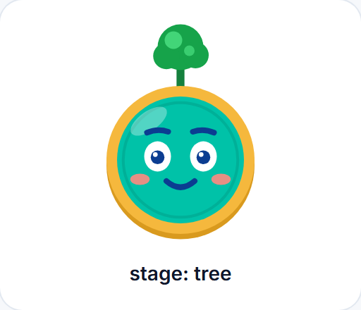 |
| New account | First investment confirmed | Auto-invest activated | 3+ contributions |

- **He grows with you.** The sprout on Pal's head follows your progress and never shrinks. When it grows, Pal celebrates with a short message ("Look at that. Your first leaves.").
- **He shows how he feels.** Eight moods follow the conversation: waving hello, listening while you type, thinking while he checks your numbers, excited when he finds money that can start working, serious and calm when he explains risks, proud when you invest, and a little sheepish if something fails. Every animation respects the system's reduced-motion setting.
- **Passionate, but responsible.** Pal is enthusiastic about habits and long-term thinking, never about getting rich quick. He never promises returns, never creates urgency, always protects the emergency fund first, and never moves money: every action is a *Review & confirm* card and the decision is yours.
- **He pushes back kindly.** Ask him to put everything into one stock, invest the emergency fund, borrow to invest or gamble on crypto, and he explains why it's risky, offers a safer alternative and respects your decision.
- **He speaks your language.** Pal replies in English, Spanish or Portuguese, in short messages and plain words, with no jargon and no emoji (his face carries the emotion).

| Wave | Listening | Thinking | Excited | Serious | Proud | Oops |
|---|---|---|---|---|---|---|
| 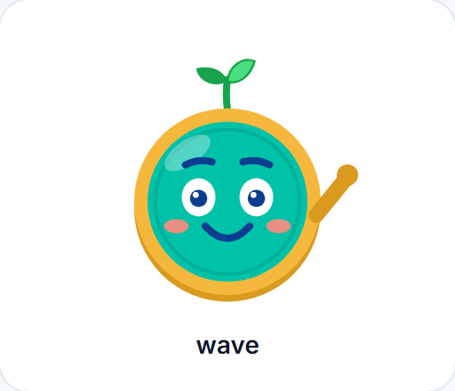 | 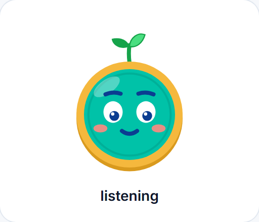 | 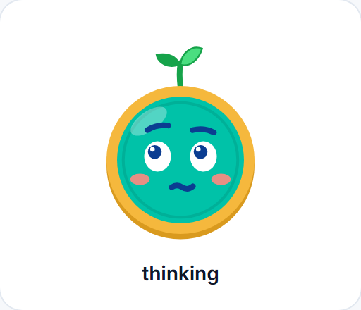 | 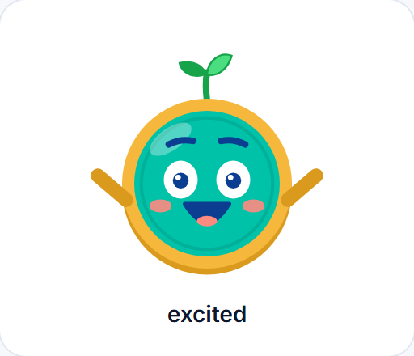 |  | 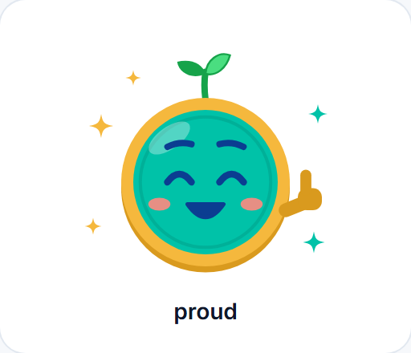 | 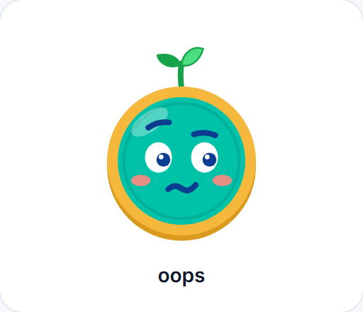 |

## How it works

Pal guides the user through one short conversation:

1. **Gets to know the user.** He asks about investing experience, what the money is for, the time horizon, and how they would react to a 10% drop.
2. **Learns from real activity.** With the user's permission, he reads the balance and the cash flow of the last 12 months through his tools.
3. **Protects the safety net.** He sets aside an emergency fund of three months of expenses and only then calculates how much can be invested.
4. **Builds a starter portfolio** that matches the risk profile and explains each line.
5. **Explains the risks** in plain language: what could go wrong, how much it could drop in a bad year, and why time matters.
6. **Waits for confirmation.** The proposal appears as a *Review & confirm* card. When the user confirms, the investment is funded with PayPal (or with the Finpal balance, if the user prefers) and Auto-invest is scheduled for every payday. Pal grows.

Example with the demo user: Laura has **$3,200**. Her expenses are about $920 a month, so Pal keeps **$2,760** as an emergency fund and proposes investing **$440**: 60% broad index funds ($264), 25% bonds ($110) and 15% growth stocks ($66), plus $50 every payday.

## Design decisions

- **The agent proposes, the user decides.** Pal has tools to read data and prepare actions, but no tool can move money on its own. Every movement goes through a confirmation screen in the UI.
- **Safety net first.** The amount to invest is always calculated after reserving three months of expenses. Pal never suggests investing the emergency fund.
- **Numbers come from tools, not from the model.** Every figure is calculated by a tool over real data and shown in a card. A server-side guardrail checks Pal's text as it streams: any dollar amount or percentage that doesn't come from a tool result, the user or Pal's fixed script is replaced before it reaches the screen. Even if the model passes different amounts to a tool, the server uses its own calculation.
- **Guardrails in code, not only in the prompt.** Risky requests are detected on the server (in English, Spanish and Portuguese); they always produce a pushback card and any money action in that turn is blocked, whatever the model does.
- **Reliable demo.** Model calls time out after 20 seconds and are retried once on rate limits or server errors. If the model is unavailable, a deterministic fallback completes the guided flow with the same tools, cards and voice. A daily message budget per user protects the AI budget.
- **Real payments, simulated market.** Funding uses the PayPal Orders API in the Sandbox (create, approve in the official popup or with a test card, capture). Asset prices are fixed, because the focus of this proof of concept is the guided experience, not trading.
- **Money as integers.** All amounts are stored in cents (`Int`), never as floats. Every balance change happens inside a database transaction, and each PayPal deposit is credited exactly once.
- **Mobile view through container queries.** Layouts react to the width of the app container, not the browser window, so mobile mode works on a desktop monitor. The phone frame is a real container, not an iframe, so the PayPal popup works inside it.
- **Private demo for every visitor.** *Try the demo* creates an isolated copy of Laura's account, so judges never share data.
- **Original brand.** Finpal and Pal are original designs with their own name, logo, colors and typography. The only PayPal elements are the official ones provided by its SDKs.

## Features

| Pal | Wallet, invest and activity |
|---|---|
| Guided onboarding conversation with streaming responses | Add money with the PayPal Checkout button (PayPal or test card) |
| Reads balance and 12-month cash flow through tools | Withdraw to a PayPal account with Payouts |
| Calculates the emergency fund and the investable amount | Send and request money between your demo contacts |
| Builds a portfolio for the risk profile | Portfolio summary: total value, cash and invested amounts |
| Plain-language risk cards and kind pushback on risky requests | Positions and assets in AG Grid, with sorting and filters |
| Review & confirm card before any money moves | Allocation donut by category and Buy / Sell |
| Animated character with moods and growth stages | Auto-invest calendar with editable recurring plans |
| Visible tool steps, quick replies, rotating "thinking" lines and a Stop button | Full transaction history in AG Grid, with PayPal IDs and *Demo data* labels |

Errors the app handles: payment cancelled or popup closed, payment method declined (the popup lets the buyer choose another), payment still pending, order not captured, insufficient balance, invalid amount, AI timeout and daily AI limit. PayPal errors show the PayPal debug ID.

## Hackathon tools

| Tool | How Finpal uses it |
|---|---|
| PayPal | Orders API (create and capture with `PayPal-Request-Id`) to fund the wallet and investments, the JS SDK Checkout button (PayPal and card), Payouts API for withdrawals, Webhooks to reconcile captures and refunds, and the Agent Toolkit (`create_order`) for the deposit orders Pal prepares |
| AG Grid | Portfolio, asset and activity tables, themed with Finpal tokens |
| Render | Hosting for the web app (PostgreSQL on Render, Neon or Supabase) |

**AI:** Claude (Anthropic) powers Pal at runtime through OpenRouter, with tool calling and streaming.

## Stack

| Layer | Technologies |
|---|---|
| App | Next.js 15 (App Router), React, TypeScript, Tailwind CSS, shadcn/ui, framer-motion |
| Character | Pal: animated SVG React component (framer-motion), static export in `public/pal.svg` |
| Auth | Auth.js (JWT session in an httpOnly cookie, no passwords) |
| Data | Prisma, SQLite (local), PostgreSQL (production) |
| Payments | `@paypal/react-paypal-js`, `@paypal/paypal-server-sdk`, `@paypal/agent-toolkit`, PayPal Payouts and Webhooks REST APIs |
| AI | Claude (Anthropic) through OpenRouter, using the OpenAI-compatible SDK with tool calling and streaming |
| Tables | AG Grid Community |
| Validation | zod |
| Quality | Vitest, Testing Library, Playwright, GitHub Actions |
| Hosting | Render |

## Structure

```text
.
├── app/                 Pages (Welcome, Home, Payments, Invest, Activity, Profile) and server actions
│   └── api/             Pal (streaming), PayPal orders / capture / webhook, Auth.js, health
├── components/
│   ├── pal/             Pal character, moods, growth stages, launcher and onboarding card
│   └── ...              Brand, device frame, chat, AG Grid tables, Auto-invest calendar
├── lib/
│   ├── assistant/       Pal's system prompt, agent loop, tools, guardrails, fallback and chat cards
│   ├── demo/            Demo spaces and seed data
│   ├── pal.ts           Growth stages and stage rules (pal-stage.ts stores them per user)
│   ├── paypal.ts        PayPal Server SDK, Payouts, Webhooks and Agent Toolkit client
│   ├── wallet.ts        Deposits and withdrawals (atomic, idempotent)
│   ├── cashflow.ts      12-month income, expenses and emergency fund
│   └── money.ts         Helpers for amounts in cents
├── prisma/              SQLite schema and migrations; prisma/postgres for production
├── tests/               Unit and integration tests (Vitest) and E2E (Playwright)
├── scripts/             Deploy seed, demo cleanup, E2E server, Pal SVG export, assistant smoke test
├── docs/                Screenshots, Devpost copy, demo script and engineering notes
├── .github/workflows/   CI
└── render.yaml          Render deployment
```

## How to run it

**Requirements:** Node.js 20 or newer, a [PayPal Developer](https://developer.paypal.com/) account with a Sandbox app, and an [OpenRouter](https://openrouter.ai/keys) API key (optional: without it, set `AI_FORCE_FALLBACK=1`).

**1. PayPal Sandbox credentials**

1. In the PayPal Developer Dashboard, go to *Apps & Credentials* and create a Sandbox app.
2. Copy the **Client ID** and the **Secret**.
3. In *Sandbox accounts*, make sure you have a personal test account with balance. You will use it to approve payments.

**2. Install and configure**

```bash
git clone https://github.com/dechouriog/Finpal.git
cd Finpal
npm install
cp .env.example .env     # fill in the PayPal and OpenRouter keys, AUTH_SECRET (npx auth secret), DEMO_RECORDING_KEY;
                         # PAYPAL_ENV=sandbox, DATABASE_URL="file:./dev.db"
```

**3. Database and demo data**

```bash
npx prisma migrate dev
npm run seed             # creates the sample assets and the reserved Laura account (safe to re-run)
```

**4. Start**

```bash
npm run dev              # http://localhost:3000
```

Use the **Desktop | Mobile** toggle at the top, or open `http://localhost:3000/?device=mobile`. In development, `http://localhost:3000/dev/pal` shows Pal in every mood and growth stage.

## Testing for judges

**Live app:** `https://YOUR-APP.onrender.com` (no sign-up)

1. Open the app and tap **Try the demo**. You get your own private copy of Laura's account: $3,200, 12 months of history and two contacts, Maria and Sam.
2. Switch to **Mobile** at the top for the intended experience.
3. Pal waves from the welcome card. Tap **Help me start investing** and answer with the quick replies.
4. Tap **Review & confirm**, keep **Pay with PayPal** selected and tap **Confirm & fund**. Then pay in the PayPal Sandbox with either option:
   - **PayPal sandbox account:** email `finpal-judges@personal.example.com` (the password is in the Devpost testing instructions).
   - **Debit or Credit Card:** use a test card from the PayPal Developer Dashboard (*Testing Tools* > *Credit Card Generator*), any future expiry date and any CVV.
5. Watch Pal grow, then check the result in **Invest** and **Activity**. Use **Profile → Reset demo data** to start again.

Try asking Pal something risky, like *"Can I put all my money into one stock?"*, to see how he pushes back. You can also try **Add money**, **Withdraw** (to the sandbox email above) and **Send / Request** with Maria and Sam.

| Real | Simulated |
|---|---|
| PayPal Sandbox orders, captures, Payouts and webhooks (test money) | Asset prices are fixed and illustrative; no real securities |
| Pal (Claude) with tool calling over your demo account's data | The 12-month history is seeded demo data, labeled *Demo data* |
| Wallet ledger, transfers, buys and sells in PostgreSQL | Auto-invest runs are scheduled and shown, not executed by a background job |

### Demo accounts

- **Try the demo** creates an isolated demo space for each visitor (signed in with a secure, httpOnly Auth.js session cookie). Demo users can only see and pay the contacts in their own space, so judges and teammates never share data.
- Seeded movements are labeled **Demo data** in Activity.
- New demos are rate-limited to 5 per hour per IP address.
- A reserved account (`laura@finpal.demo`) is used to record the pitch video. It is only reachable through `/demo/laura?key=<DEMO_RECORDING_KEY>` and is not linked in the UI.
- `npm run cleanup:demo` deletes demo spaces older than 7 days. **Do not run it before Dec 16, 2026** (judging ends Dec 15); the script refuses to run earlier unless forced.

## Deploy on Render

`render.yaml` defines the web service (Starter plan, health check on `/api/health`). The build runs `prisma migrate deploy` with the PostgreSQL schema and then an idempotent seed that only creates the asset catalog and the reserved Laura account.

**1. Database.** Render's free PostgreSQL expires after 30 days and judging runs until Dec 15, 2026, so use one of:

- **Render PostgreSQL (paid plan):** copy its *Internal Database URL*.
- **Neon:** create a project and copy the connection string (it includes `?sslmode=require`).
- **Supabase:** *Project Settings* > *Database* > connection string, *Session* mode (port 5432), with `?sslmode=require`.

**2. Create the service:** *New* > *Blueprint* > this repository, then set these environment variables:

| Variable | Value |
|---|---|
| `DATABASE_URL` | PostgreSQL connection string from step 1 |
| `AUTH_SECRET` | Generated automatically by the Blueprint |
| `DEMO_RECORDING_KEY` | Any random string (16+ characters) |
| `PAYPAL_CLIENT_ID`, `NEXT_PUBLIC_PAYPAL_CLIENT_ID` | Sandbox app Client ID (same value in both) |
| `PAYPAL_CLIENT_SECRET` | Sandbox app Secret |
| `PAYPAL_WEBHOOK_ID` | Webhook ID from step 3 (optional; without it webhooks are ignored) |
| `OPENROUTER_API_KEY` | OpenRouter key (set a spending limit on the key) |
| `PAYPAL_ENV`, `OPENROUTER_MODEL`, `AI_DAILY_LIMIT`, `NODE_VERSION` | Preset in `render.yaml` |

**3. PayPal dashboard.** In your Sandbox app, add a webhook with URL `https://YOUR-APP.onrender.com/api/paypal/webhook` and the events `PAYMENT.CAPTURE.COMPLETED`, `PAYMENT.CAPTURE.DENIED` and `PAYMENT.CAPTURE.REFUNDED`. Copy its Webhook ID into `PAYPAL_WEBHOOK_ID`. No return URL is needed: checkout happens in the PayPal popup.

**Cold starts.** The Starter plan keeps the service running. On the free plan, the service sleeps when idle; a free uptime monitor (for example UptimeRobot) that pings `/api/health` every 10 minutes keeps it awake.

**Schema changes.** Production uses `prisma/postgres/schema.prisma`, generated from `prisma/schema.prisma` by `node scripts/sync-postgres-schema.mjs` (CI checks it is in sync). Create PostgreSQL migrations with `npx prisma migrate dev --schema prisma/postgres/schema.prisma` against a PostgreSQL database.

## Quality

```bash
npm run lint && npm run typecheck
npm test            # 56 unit and integration tests (Vitest, isolated SQLite test database)
npm run test:e2e    # Playwright, Desktop and Mobile (Pal in fallback mode, PayPal popup mocked)
```

The suite covers the money logic (cents, transfers, overdraft races), the $440 emergency-fund math, portfolio allocation, Auto-invest dates, every API route, data isolation between demo users, Pal's moods, growth stages and reduced motion, and Pal's guardrails with a scripted model (invented numbers are removed, risky requests never produce an action).

GitHub Actions runs all of the above plus a production build on every push. Security notes are in [SECURITY.md](SECURITY.md) and a summary of the engineering work is in [docs/engineering-notes.md](docs/engineering-notes.md).

## Status and limitations

This is a prototype built for the hackathon:

- Payments use the PayPal Sandbox, not real money.
- Asset prices are fixed and illustrative. There is no real brokerage or real securities.
- The 12-month history of the demo user is seeded in the database, because the Sandbox does not easily expose the history of a personal account.
- Auto-invest runs are scheduled and shown in the calendar, but no background job executes them yet.
- Rate limits are kept in memory, which fits a single web instance.
- Pal gives educational information. It is not financial advice.

## Roadmap

- Bryntum Calendar view for Auto-invest (plans are already stored as iCal recurrence rules, the format Bryntum uses).
- Live price feed for assets (the integration point is marked in the code).
- Scheduled job that executes Auto-invest runs on each payday, so Pal keeps growing on his own.

## License

[MIT](LICENSE)
